

  <a href="https://dequavious.dev">
    <picture>
      <source media="(prefers-color-scheme: dark)" srcset="assets/img/banner-dark.svg">
      
    </picture>
  </a>

  <b>I build products end to end, then I run them.</b> 
  Known online as Dequavious. Computer Science, University of Westminster, London.

  <a href="https://dequavious.dev"><b>Website</b></a> &nbsp;·&nbsp;
  <a href="https://usehelm.host"><b>Helm</b></a> &nbsp;·&nbsp;
  <a href="https://www.linkedin.com/in/khaled-jamal"><b>LinkedIn</b></a> &nbsp;·&nbsp;
  <a href="https://x.com/dequavious7th"><b>X</b></a> &nbsp;·&nbsp;
  <a href="https://www.crunchbase.com/person/khaled-jamal-7a6a"><b>Crunchbase</b></a> &nbsp;·&nbsp;
  <a href="https://dequavious.dev/start-a-project"><b>Start a project</b></a>

  <picture>
    <source media="(prefers-color-scheme: dark)" srcset="assets/img/divider-dark.svg">
    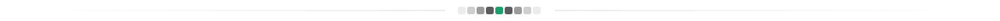
  </picture>

<h3 align="center">What I run</h3>

  <a href="https://usehelm.host">
    <picture>
      <source media="(prefers-color-scheme: dark)" srcset="assets/img/helm-dark.svg">
      
    </picture>
  </a>

<h3 align="center">What else I build</h3>

  <a href="https://dequavious.dev"><picture><source media="(prefers-color-scheme: dark)" srcset="assets/img/bifrost-dark.svg">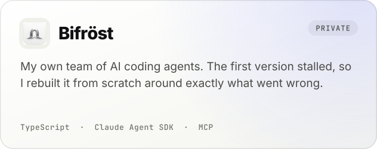</picture></a>
  <a href="https://github.com/PulseAgenticTrader"><picture><source media="(prefers-color-scheme: dark)" srcset="assets/img/pulse-dark.svg">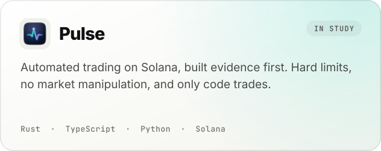</picture></a>

  <a href="https://soltools.net"><picture><source media="(prefers-color-scheme: dark)" srcset="assets/img/soltools-dark.svg"></picture></a>
  <a href="https://github.com/dequaviousthe7th/file-converter-pro"><picture><source media="(prefers-color-scheme: dark)" srcset="assets/img/file-converter-dark.svg">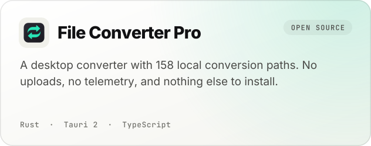</picture></a>

  <a href="https://thetrencher.wtf"><picture><source media="(prefers-color-scheme: dark)" srcset="assets/img/trencher-dark.svg"></picture></a>
  <a href="https://gossima.app"><picture><source media="(prefers-color-scheme: dark)" srcset="assets/img/gossima-dark.svg">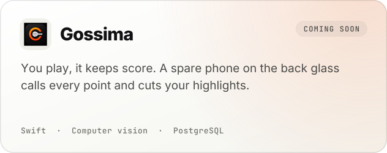</picture></a>

<h3 align="center">Built for clients</h3>

  <a href="https://croffee.cafe"><picture><source media="(prefers-color-scheme: dark)" srcset="assets/img/croffee-dark.svg"></picture></a>
  <a href="https://kagedproduction.co"><picture><source media="(prefers-color-scheme: dark)" srcset="assets/img/kaged-dark.svg"></picture></a>

<h3 align="center">What I build with</h3>

  <picture>
    <source media="(prefers-color-scheme: dark)" srcset="assets/img/stack-dark.svg">
    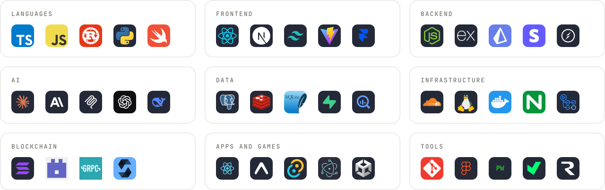
  </picture>

  <picture>
    <source media="(prefers-color-scheme: dark)" srcset="assets/img/divider-dark.svg">
    
  </picture>

  <b>Got something to build?</b> <a href="https://dequavious.dev/start-a-project">Tell me about it</a>, and you'll have a fixed price and a date within 24 hours.

  Most of my code is private, so this page shows what it became. The banner redraws itself from my real activity every day.

